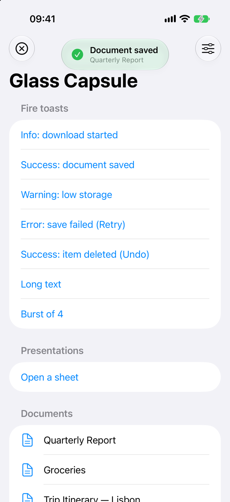
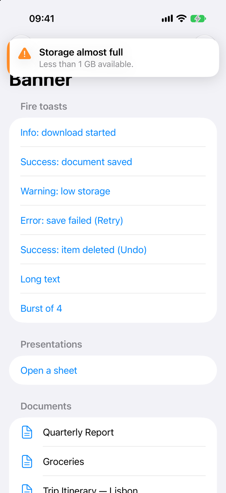
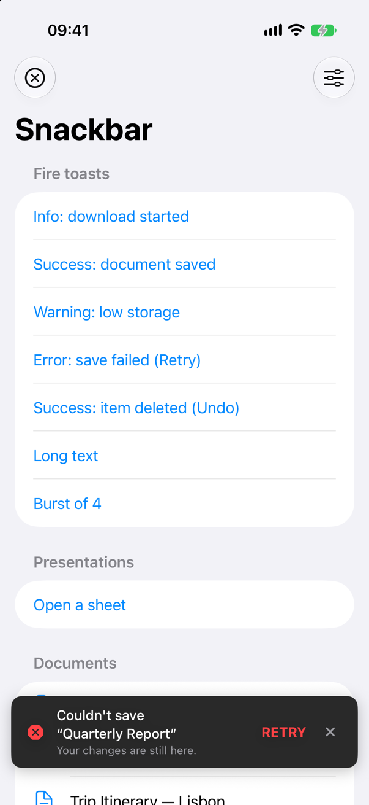
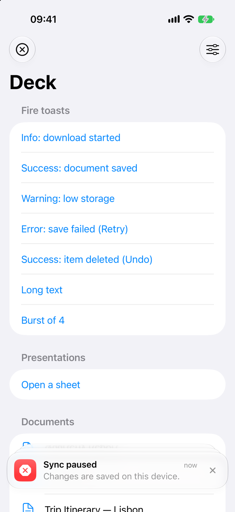

# GruffixToasts

App-wide toast messages for SwiftUI on iOS 17, macOS 14, tvOS 17 and watchOS 10 and later. Install one toast center
at the root of a window and show toasts from any view beneath it, including above sheets and other presentations.

1. Four built-in styles, Glass Capsule, Banner, Snackbar and Deck, or one of your own.
2. Stack or queue presentation, with durations set by severity.
3. Swipe to dismiss, haptics, actions such as Retry and Undo, and VoiceOver announcements.
4. One API on every platform, adapted to each one's conventions.

| Glass Capsule | Banner | Snackbar | Deck |
| --- | --- | --- | --- |
|  |  |  |  |

## Installation

In Xcode, choose File > Add Package Dependencies, enter `https://github.com/gruffixlabs/gruffix-toasts`, and add the
`GruffixToasts` library to your app target.

In a `Package.swift`:

```swift
dependencies: [
    .package(url: "https://github.com/gruffixlabs/gruffix-toasts", from: "0.1.0"),
],
targets: [
    .target(
        name: "MyApp",
        dependencies: [.product(name: "GruffixToasts", package: "gruffix-toasts")]
    ),
]
```

## Quick start

Install a `ToastCenter` once at the root, then show toasts from any descendant:

```swift
import GruffixToasts
import SwiftUI

@main
struct MyApp: App {
    var body: some Scene {
        WindowGroup {
            RootView()
        }
    }
}

struct RootView: View {
    @State private var toasts = ToastCenter(tuning: ToastTuning(style: .glassCapsule))

    var body: some View {
        ContentView()
            .toastHost(toasts)
    }
}
```

```swift
@Environment(\.toastCenter) private var toasts

toasts.success("Document saved", detail: "Quarterly Report")
toasts.error(error, action: ToastAction(label: "Retry") { save() })
```

`info`, `success`, `warning` and `error` each have a shortcut; `show(_:)` takes a `Toast` you build yourself.
`ToastTuning` controls style, placement, durations and motion.

## Documentation

The full documentation, including Getting Started, custom styles and platform differences, is at
<https://gruffixlabs.github.io/gruffix-toasts/>.

## Demo

`Demo/` holds a playground app for iOS and macOS that uses the package from this checkout. Open
`Demo/ToastsDemo.xcodeproj` and run it, or use the `#Preview`s in `ToastPlayground+Previews.swift` to compare
styles and states. The tuning panel there edits `ToastTuning` live.

## Contributing and license

Contributions are welcome; see [CONTRIBUTING.md](CONTRIBUTING.md). GruffixToasts is released under the
[MIT License](LICENSE).
